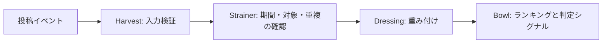

# 🥗 SaladBowl Algorithm

サラダボウルの投稿・共有・継続性を評価するランキングエンジン。

**Engine: Dressing** · **Python 3.11+** · **Standard library only** · **JST**

分類済みの投稿イベントを読み込み、貢献スコアとギア判定用のシグナルを出力します。
情報の件数だけでなく、考察、商材の幅、日記、共有の継続性を評価します。

## 評価するもの

<!-- policy:start -->
| 入力・条件 | 評価 |
|---|---|
| 通常の情報共有 | +13.5 / 件 |
| 抽選リンク | +13.5 / 件 |
| Joshin | 情報評価の対象外。共有件数・連続投稿日にも含めない |
| ライポケ | 直近14日で10件以上 → +75。期間内に1回加算 |
| 考察系の投稿 | +75 / 件 |
| カード以外の商材 | 情報・抽選リンク・考察の点数に +27 / 件 |
| 日記 | +39 / 件 |
| ホノアへのアクション | +1 / 投稿 |
| ホノアの引用ツイート | 通常アクションの2倍（+2 / 投稿） |
| ギア1 → ギア2の復帰 | ギア1に落ちた後、5日連続で有効な共有 → 復帰候補 |
| ギア2の維持 | 直近14日間に1回以上の有効な共有 |
| ゲスト制度 | 準備中。採点・ギア判定への接続は今後の拡張 |
<!-- policy:end -->

点数と期間の定義は [settings.toml](settings.toml) に集約しています。この表も同じ設定から生成します。

ホノアへのアクション・引用の対象アカウントは [ホノア（@unboxhabit_）](https://x.com/unboxhabit_) です。

## Dressing pipeline



| 部品 | 担当 |
|---|---|
| **Harvest** | メンバー、投稿種別、時刻、情報源を検証 |
| **Strainer** | 対象期間外、Joshin、重複した共有を除外 |
| **Dressing** | 投稿種別と商材に応じて点数を加算 |
| **Bowl** | 内訳付きランキングと、ギア2の復帰・維持シグナルを出力 |

## 集計の読み方

- 日付の境界は日本時間。対象期間は今日を含む暦日で数え、評価時刻より未来の投稿は含めません。
- 同じ人が同じ情報源の同じ内容を繰り返し共有しても、期間内では最初の1件だけを数えます。
- ライポケの件数も、重複を除いた共有件数です。達成ボーナスは期間内に1回だけ加算します。
- 同じホノア投稿への通常アクションと引用がある場合は、引用の評価を採用します。両方の点数を足す扱いにはしません。
- 有効な共有は、情報・抽選リンク・考察・日記。ホノアへのアクションだけでは、連続投稿日やギア2維持の共有回数は増えません。
- 復帰の連続日数は、ギア1に落ちた時刻以降の有効な共有を数えます。今日まだ投稿がない場合は、昨日までの連続記録を評価します。
- スコアとギア判定は別々に出力します。復帰候補・維持条件の充足は確認用のシグナルです。ギア3・4の昇格境界は、この公開範囲には含めていません。

## 手元で動かす

Python 3.11 以降で、リポジトリのフォルダから実行します。追加パッケージのインストールは不要です。

```bash
python -m dressing examples/sample.json
```

Windows で `python` が見つからない場合は `py -3`、macOS / Linux では `python3` を使ってください。

評価時刻も入力に含めるため、同じ入力と設定からは同じ結果になります。
サンプルの結果は [examples/expected.json](examples/expected.json) で確認できます。

```bash
python -m unittest discover -s tests -v
python tools/sync_readme.py --check
```

設定を変更したら、表も更新できます。

```bash
python tools/sync_readme.py
```

## 入出力

[入力形式](docs/input-format.md)に従った JSON を受け取り、標準出力に JSON を返します。
出力にはスコアの内訳、有効な共有数、ライポケの達成状況、復帰の連続日数が含まれます。

入力の投稿分類は呼び出し元で行います。この実装の入出力はファイルと標準出力です。

## 通知と抽選リンク

サラダボウルでは、通知と抽選リンクを入口に、情報を共有する人が次の情報を受け取れる循環を目指します。

[サラダボウルに参加する](https://discord.com/invite/hfyPfgGb37)

## Guest access

ゲスト制度は準備中です。現在の機能状態は `planned`。利用範囲と受付方法は、今後の更新で案内します。

## 構成

```text
settings.toml           評価ルール
dressing/               入力検証・集計・CLI
examples/               入力例と期待する出力
tests/                  期間境界・重複・判定・異常入力のテスト
tools/sync_readme.py     説明書と設定の同期
docs/input-format.md    データ形式
```

## License

[MIT](LICENSE)

